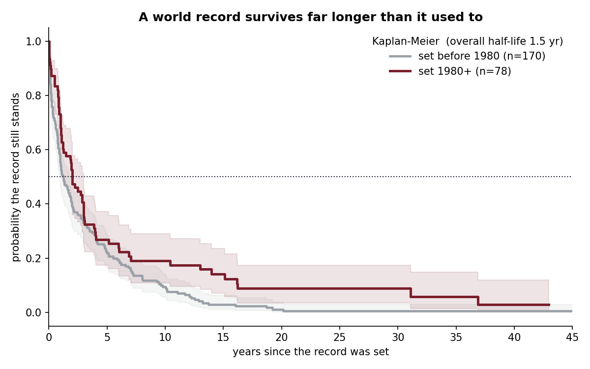
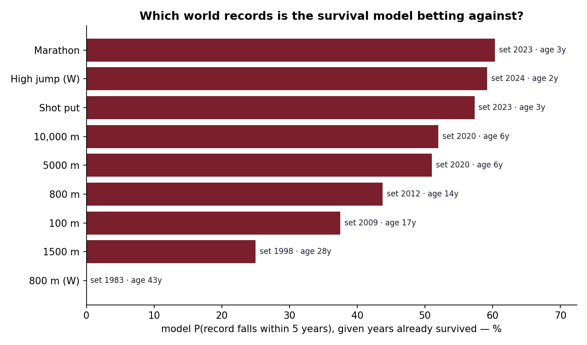

# World-Record Half-Lives

Design and copy follow [these standards](https://github.com/lyhjeremy/lyhjeremy/blob/main/DESIGN_STANDARDS.md).

**How long does a track & field world record stand, and which of today's records is the survival model betting against?**

> **Overview:** https://lyhjeremy.github.io/world-record-half-lives/
> **In depth:** https://lyhjeremy.github.io/world-record-half-lives/overview/

Athletics world records don't fall randomly. Some are broken within months; others, Kratochvílová's 800 m from **1983**, have outlasted the careers of everyone who
has chased them. This project treats each record as a *survival-time* problem:
every record "lives" until the next one breaks it, and the records still standing
today are **right-censored**. From ~250 record reigns across nine events I fit a
**Kaplan-Meier** survival curve, a **Cox proportional-hazards** model of what makes
a record fall sooner, and turn the model on the current records to estimate each
one's probability of falling in the next five years.

<p align="center">
  
</p>

## What it finds

- **A record's hazard is front-loaded.** The Kaplan-Meier *half-life* of a record
  is only about **1.5 years.** Most records are beaten quickly. But that median
  hides a heavy tail: the records still standing have all survived the dangerous
  early window.
- **Records last far longer than they used to.** Split by era, a record set in
  1980 or later survives markedly longer than a pre-1980 record (see the curves),
  and the Cox model agrees: being a modern record roughly **halves** the hazard
  (HR ≈ 0.52).
- **Big leaps last.** The larger the improvement that *set* a record, the longer it
  survives (HR ≈ 0.65 per unit), Beamon-style jumps buy durability.
- **Vulnerability today.** Given how long each current record has already stood, the
  model's five-year fall probabilities run from **~60% (the 2023 marathon record,
  in the super-shoe era)** down to **~0% (the 42-year-old women's 800 m)**.

<p align="center">
  
</p>

## Data: verified complete, not just scraped

Progressions come from Wikipedia's "… world record progression" pages
(`pandas.read_html`). These pages mix the chronological progression with all-time
top-lists and nav-boxes, so a naïve scrape silently truncates or contaminates an
event's history. The fetcher therefore keeps an event **only if its reconstructed
running-best equals the current ratified world record** (and its history reaches
back far enough). A hard completeness check. Nine events pass cleanly: 100 m,
800 m, 1500 m, 5000 m, 10,000 m, marathon and shot put (men), plus the women's
800 m and high jump. Events whose modern records live in tables the scraper can't
reliably isolate are dropped rather than analysed half-complete.

## Run it
```bash
pip install -r requirements.txt
python fetch_data.py      # scrape + verify progressions -> data/raw/ (git-ignored)
python analyze.py         # survival models + curve fits -> figures/ + tables/
```

## Files
| Path | What it is |
|---|---|
| `fetch_data.py` | Scrape Wikipedia progressions; keep only events verified complete vs the real WR |
| `analyze.py` | Reconstruct reigns → Kaplan-Meier + Cox + asymptotic fits → figures & tables |
| `figures/` | Survival curve, progression fits, vulnerability ranking |
| `tables/` | `record_reigns.csv`, `cox_summary.csv`, `current_record_vulnerability.csv` |

## Caveats
Reigns are reconstructed from ratified progressions, so the model sees *when* records
fell but not the live "pressure" on them (how many athletes are within 1% right now)
a natural next feature. Estimated event "limits" are omitted from the headline
because for still-improving events the asymptote isn't statistically identifiable;
the vulnerability score leans on the survival model instead, which needs no such
extrapolation.

## License
[MIT](LICENSE) © 2026 Jeremy Lee · record data from Wikipedia
