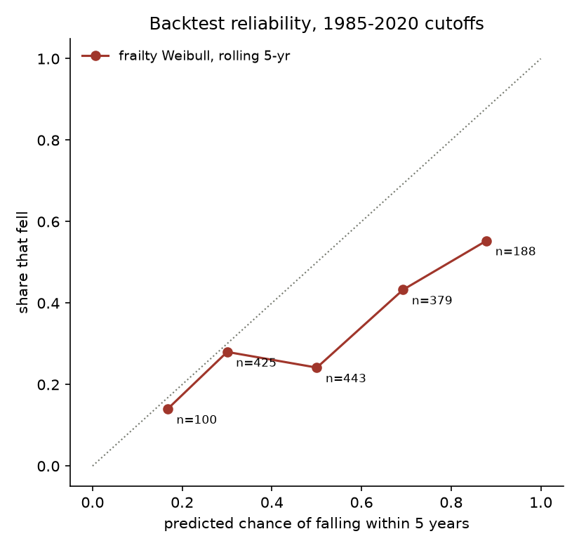

# World-record half-lives

A survival analysis of every ratified athletics world record in the 46 Olympic events: how long records stand, what makes them last, how well that forecasts what actually fell, and which of today's records is most likely to go before the LA 2028 Olympics close.

[Live site](https://lyhjeremy.github.io/world-record-half-lives/) · [Write-up and watchlist](https://lyhjeremy.github.io/world-record-half-lives/overview/) · [Long-form notes](writeup.md) · [Data decisions](docs/data_decisions.md)

Design and copy follow [these standards](https://github.com/lyhjeremy/lyhjeremy/blob/main/DESIGN_STANDARDS.md).

## Results (October 2026)

| Result | Value |
|---|---|
| Records and reigns | 1,464 ratified records, 1,251 reigns, 46 events (men and women) |
| Kaplan-Meier median reign, all events | 1.1 years (sprints 3.0, jumps 0.8, throws 0.9) |
| Backtest, fit to 2010, scored on 2011 to 2025 (46 records, 26 fell) | Brier 0.235 (base rate 0.329, Kaplan-Meier method 0.250), AUC 0.70 |
| Brier gain over the base rate at the 2010 cut | 0.093, 90% interval 0.030 to 0.157 |
| Rolling backtest, 1985 to 2020, five-year horizon (1,535 predictions) | Brier 0.254 (base rate 0.335); predictions of 40 to 60% came true 24% of the time |
| Hazard ratio, at risk since 2000 (against 1980 to 1999) | 0.53 |
| Hazard ratio per percentage point of improvement | 0.79 (95% CI 0.73 to 0.85) |
| Most likely to fall before 30 July 2028 | Duplantis's 6.31 pole vault, 48% (90% interval 19 to 57%) |
| Least likely | Griffith Joyner's 10.49 and the US 4x400 m 2:54.29, 5% |

The model is overconfident: in the rolling backtest, records fell less often than it predicted whenever it said more than about 40%. Its ranking is more useful than its levels. Details and the reliability table are on the [write-up](https://lyhjeremy.github.io/world-record-half-lives/overview/).

<p align="center">
  
</p>

## Method

1. **Data.** `fetch_data.py` parses the "Progression of Official World Records" section of World Athletics' Oregon22 statistics handbook (every ratified record to 31 May 2022) and adds the 30 records ratified since, from World Athletics' progression pages (`sources/updates_2022_2026.csv`). Ratified road records (marathon, 20 km walk) start in 2003 and 2004 and are in `sources/road_ratified.csv`.
2. **Checks.** `crosscheck_wikipedia.py` looks for every record on Wikipedia (1,456 of 1,464 match on mark and year). `validate.py` fails unless all 46 current records match World Athletics' records page as of 28 October 2026, and flags every reign over 20 years and every unusually large jump for a look-up (95 flags, all explained in `tables/validation_flags.csv`).
3. **Reigns.** `reigns.py` turns the lists into survival times. Hand-timed records are censored when World Athletics stopped accepting them (1 January 1977) and early automatic records enter the risk set in 1975; javelin lists restart with the 1986 and 1999 implements; equalling marks do not end a reign. The full rule set is in [docs/data_decisions.md](docs/data_decisions.md).
4. **Models.** `analyze.py` fits Kaplan-Meier (overall and by event group), a Cox model with a proportional-hazards test, Weibull, log-normal and log-logistic AFT models, and the main model: a Weibull proportional-hazards model with a shared gamma frailty per event, fitted by maximum marginal likelihood in SciPy. Reigns are split at each 1 January so two covariates can change over a record's life: the calendar period it is at risk in, and the number of records its event has seen in the last three years.
5. **Backtest.** Refit on what was known at the end of 2010 (and 2000), with records still standing censored at the cut, and score each standing record's predicted chance of falling in the next 15 years against what happened. A rolling version refits at every year end from 1985 to 2020 with a five-year horizon. Baselines: the historical base rate, a pooled constant rate, and the Kaplan-Meier method of the July version.
6. **Forecast.** For every current record, the chance it falls before 30 July 2028 and within five years. Intervals come from 200 refits on resampled events.

## Stack

Python, pandas, NumPy, SciPy, lifelines, matplotlib, poppler (`pdftotext`). The site is static HTML on GitHub Pages; the write-up's watchlist, reliability chart and survival curves are plain SVG and JavaScript drawn from `web/data.json`.

## How to run

```bash
python -m venv ~/venvs/world-record-half-lives
~/venvs/world-record-half-lives/bin/pip install -r requirements.txt
# needs pdftotext (brew install poppler)
python fetch_data.py            # handbook PDF -> ~/data-cache/..., tables/progressions.csv
python crosscheck_wikipedia.py  # tables/wikipedia_crosscheck.csv
python validate.py              # end points, gap and jump flags; non-zero exit on failure
python analyze.py               # models, backtests, watchlist, figures/, tables/, web/data.json
```

`analyze.py` takes about 80 seconds. The forecast date is fixed at 28 October 2026 (`TODAY` in `analyze.py`); move it and the current-records file together.

## Repo layout

| Path | What it is |
|---|---|
| `fetch_data.py`, `sources/` | Handbook parser and the hand-checked 2022 to 2026 updates, road records and current records |
| `crosscheck_wikipedia.py`, `validate.py` | Cross-check and validation |
| `reigns.py` | Records to reigns |
| `analyze.py` | Models, backtests, forecast, figures and `web/data.json` |
| `docs/data_decisions.md` | Every data rule and every dropped record |
| `tables/` | Progressions, reigns, model tables, backtests, reliability, watchlist |
| `figures/` | Survival by group, backtest reliability, watchlist |
| `archive/2026-07/` | Figures and the vulnerability table from the July 2026 version |
| `index.html`, `overview/` | The two pages of the site |

## Limitations

- The model knows when records fell and how busy each event has been, not who is close now. It probably understates the pole vault, where Duplantis has set the record 15 times since 2020, and overstates the women's pole vault, where the event's busy past lifts its frailty.
- The backtest is small (46 records at the 2010 cut) and the rolling version reuses the same records, so its predictions are not independent.
- The calendar-period and recent-record covariates were added after seeing the first backtest, so the final model's backtest scores are not a clean holdout of that choice. All three model versions are reported in `tables/backtest_summary.csv`.
- Holder age is not in the model: the handbook has no dates of birth.
- Two marks were pending ratification on 28 October 2026 (Russell's 12.09 100 m hurdles and dos Santos's 45.80 400 m hurdles). They are noted on the watchlist, not modeled.

## July 2026 version

The first version analysed 248 reigns in 9 events scraped from Wikipedia. Its headline numbers (median reign 1.5 years, a Cox hazard ratio of 0.52 for records set since 1980, five-year fall chances from 60% for the 2023 marathon to 0% for the women's 800 m) were superseded on 28 October 2026. The marathon record it ranked first had already fallen on 26 April 2026. See the dated note in [writeup.md](writeup.md).

## License

[MIT](LICENSE) © 2026 Jeremy Lee. Record data from World Athletics.
