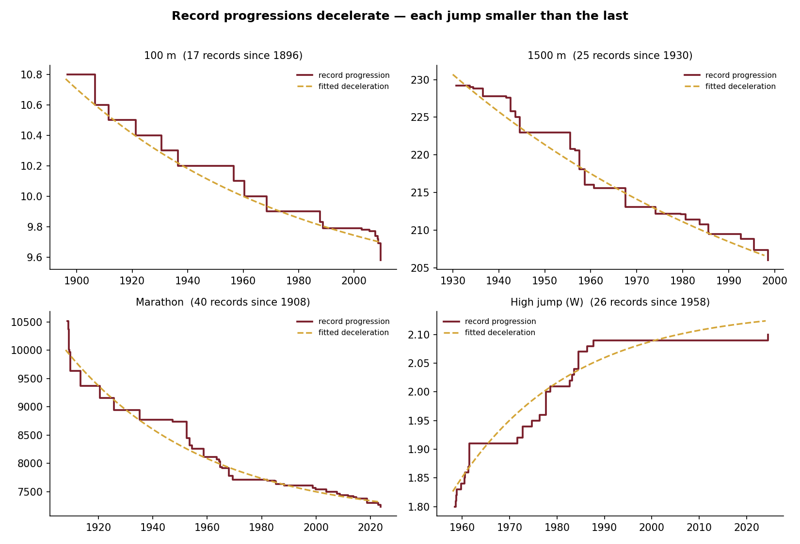

# World-record half-lives

*How long does an athletics world record stand, and which of today's records is most likely to go next?*

## October 2026 upgrade

*Written 28 October 2026. The July 2026 text follows below, with dated notes where it is superseded.*

### Why it changed

The July version had three problems I could name. It covered 9 events out of 21 candidates, because only those passed a completeness check on a Wikipedia scrape. The check looked at end points, not gaps, so the women's 800 m went in with three reigns and a misread 1925 mark that stood 55 years. And its headline forecast, a 60% chance the 2023 marathon record falls within five years, was about a record that had already fallen: Sabastian Sawe ran 1:59:30 in London on 26 April 2026.

It also never tested itself. A five-year fall probability is a forecast, and the only way to know if it is any good is to make it at some past date and see what happened.

### Data

I rebuilt the progressions from World Athletics' own lists. Its Oregon22 statistics handbook prints every ratified world record to 31 May 2022, equalling marks included, for all events and both sexes; the 30 records ratified since came from World Athletics' progression pages. That gives 1,464 records in the 46 Olympic events, which become 1,251 reigns. All 46 current records match World Athletics' records page as of 28 October 2026, and the pipeline fails if one does not. Wikipedia is now a cross-check only: 1,456 of the 1,464 records appear there with the same mark and year.

Two rule changes need handling. From 1 January 1977 World Athletics accepted only automatic timing up to 400 m, so a hand-timed record standing that day did not fall; the rule changed. Those reigns are censored at that date, and the automatic records that were back-dated to 1968 or 1972 enter the risk set when separate automatic records began, in 1975. The javelin lists restart with the new implements of 1986 and 1999. [docs/data_decisions.md](docs/data_decisions.md) has every rule and every dropped mark, including Shinnick's 8.33 long jump (added to the list in 2021) and the serrated-tail javelin marks deleted in 1991.

A validation script lists every reign over 20 years and every unusually large improvement, 95 in all, and each one was looked up. The women's 800 m now has 27 reigns from 1922; the 1925 "1:54.0" is gone.

### Model

Kaplan-Meier and a Cox model are the baseline. The Cox model's proportional-hazards test fails for era (p < 0.001), so era cannot be a single multiplier on the hazard.

The main model is a Weibull proportional-hazards model with a gamma frailty shared by each event, fitted by maximum marginal likelihood. The Weibull shape is 0.69: a record's yearly risk falls as it ages. The frailty lets each event have its own pace, estimated from its history and pulled toward the average when that history is short. Reigns are split at every 1 January so two covariates can change while a record stands: the calendar period it is at risk in, and how many records its event has seen in the past three years.

What it finds: records at risk since 2000 fall at about half the rate of those at risk in 1980 to 1999 (hazard ratio 0.53). Each percentage point of margin over the previous record cuts the hazard by a fifth (0.79). Events that have just seen records keep seeing them (1.28 per unit of log count). Throws and jumps records fall about twice as fast as sprint records; half of them are gone inside a year. By AIC this beats a plain Weibull by 66 and log-normal or log-logistic versions by more than 150.

### Backtest

I cut the data at 31 December 2010, refitted, and predicted for each of the 46 records standing that day the chance it would fall by the end of 2025. 26 fell. The model's Brier score was 0.235, against 0.329 for the historical base rate (85% of standing records had fallen within 15 years at earlier year ends) and 0.250 for the July Kaplan-Meier method. Its AUC was 0.70. Resampling events, the gain over the base rate has a 90% interval of 0.030 to 0.157.

At a 2000 cut everything did badly: the model scored 0.432 and the base rate 0.535, because both expected most records to fall and the 2000s were slow. A rolling version, refitting at every year end from 1985 to 2020 with a five-year horizon, gives 1,535 predictions. Its Brier score is 0.254 against 0.335 for the base rate, but the reliability table shows the weak spot: predictions of 40 to 60% came true 24% of the time, and of 80 to 100% only 55%. The model is overconfident because records keep getting harder to break, faster than anything in its training data says.

I should be plain about one thing. The first frailty model I specified used the era a record was set in, and scored 0.273 at the 2010 cut. I added the calendar period and the recent-record count after seeing that, so the final model's backtest is not a clean holdout of those choices. All three versions are in `tables/backtest_summary.csv`.

### Forecast

For all 46 records, the model gives the chance of falling before the LA 2028 Olympics close on 30 July 2028, and within five years, with 90% intervals from 200 refits on resampled events. Duplantis's 6.31 pole vault is first at 48% (19 to 57%), then Chebet's 13:58.06 5000 m (35%) and her 28:54.14 10,000 m (29%), and Sawe's 1:59:30 marathon (29%). The least likely are Griffith Joyner's 10.49 and the US 4x400 m 2:54.29 (5%).

The 48% for Duplantis is the clearest case of what the model can't see. He has set the record 15 times since February 2020, usually by a centimeter; the model knows the event is busy but not that one athlete is doing all of it and is still competing. The women's pole vault at 28% is the reverse: a busy past, nobody near 5.06 now. Given the backtest, the order of the list is more trustworthy than its percentages.

### Superseded numbers

*Superseded 28 October 2026.* The July headline numbers below (median reign 1.5 years; Cox hazard ratio 0.52 for records set since 1980 and 0.65 per point of improvement; five-year fall chances from 60% for the 2023 marathon to 0% for the 1983 women's 800 m) came from 248 reigns in 9 events. On the full data the median reign is 1.1 years, the median split at 1980 disappears (1.09 years before, 1.03 after), the slowdown shows up instead as a lower hazard in the period since 2000, and the margin effect holds at 0.79 per point. The women's 800 m now gets 9% before LA 2028.

---

## July 2026 version

## Records as survival times

I've run 14 marathons, so the result I looked for first was the marathon's: the men's record of 2:00:35, set in 2023, has the highest chance of any record here of falling within five years (60%). Getting to that number takes a different way of looking at records.

> **Correction, 28 October 2026.** That record had already fallen when this was written. Sabastian Sawe ran 1:59:30 in London on 26 April 2026, ratified by World Athletics in July 2026. The July pipeline checked its data against a hard-coded list of records and never noticed. The October version checks every record against World Athletics' records page.

A world record has a lifespan. It starts the day it is set and ends the day someone beats it. The records standing now haven't ended yet, which makes them censored observations: we know they have lasted at least this long, and nothing more. Survival analysis was built for exactly this kind of data.

For nine events I reconstructed the ratified progression, measured every record's reign (years until the next record broke it), and marked the nine current records as censored, which gives 248 reigns, 239 of them ended. Kaplan-Meier estimates the survival curve, a Cox proportional-hazards model tests what shortens a reign, and the curve is then applied to today's records to rank how exposed each one is.

## Getting the data right

The progressions are on Wikipedia, and `pandas.read_html` reads them in seconds. The catch is that each page also carries all-time lists, by-nation tables and navigation boxes, and for several events the modern progression sits in a table a generic scraper won't reliably find; a naive scrape can give a women's 100 m history that stops in 1973, or count a sub-2:00 marathon that was never ratified.

The fetcher therefore has a completeness gate. It rebuilds each event's running best from the scraped marks and keeps the event only if that best is within 0.5% of the current ratified record, the history reaches back to 1970 or earlier, and there are at least 12 marks. Nine of the 21 candidate events passed: the men's 100 m, 800 m, 1500 m, 5000 m, 10,000 m, marathon and shot put, and the women's 800 m and high jump. The rest were dropped.

The gate has a blind spot: it checks the end point and the start year and never looks at the gaps between them. The women's 800 m passed with only three reigns, one of them running 55 years from 1925 to 1980, which almost certainly means rows are missing.

## What the survival curve says

  

The median reign is 1.5 years. Most records don't stand for long, because the athlete who set them and the rivals chasing them are usually still competing. The curve then flattens into a long tail, and every record people think of as untouchable lives in that tail.

Split at 1980, the median is about 1.2 years for the 170 earlier records and about 2.0 years for the 78 later ones. The Cox model gives the same picture: a record set in 1980 or later has a hazard ratio of 0.52 (p < 0.001), about half the yearly risk of being broken.

The model's other clear result is about margins. Each percentage point by which a record beat its predecessor multiplies the hazard by 0.65 (p = 0.0002). A record set by a wide gap, like Beamon's long jump or Kratochvílová's 800 m, leaves the rest of the field further behind. The third covariate, distance event, came out at 0.78 with p = 0.07, which I don't treat as a finding.

## Progressions flatten

  

Every progression decelerates, with each new record taking off less than the one before, and that shape is consistent enough to fit. The limit itself is another matter. For events still dropping fast, the asymptote runs off to wherever the optimizer lets it, so I don't report a number. Where a progression has plainly leveled off, as with the women's 800 m and the women's high jump near 2.10 m, the plot shows it without a fit.

## Which records fall next?

  

Because the risk is concentrated early, the simplest forecast comes straight from the survival curve. For a record that has already stood *t* years, the chance it falls in the next five is 1 − S(t+5)/S(t). Recent records sit on the steep part of the curve and score high: the 2023 marathon (60%), the 2024 women's high jump (59%) and the 2023 shot put (57%). *(Superseded 28 October 2026: the 2023 marathon record was no longer standing; see the correction above and the October section for current numbers.)* Older records have already passed the steep part. The 1983 women's 800 m scores 0%.

That zero is partly an artifact. No reign in the data ends between 43 and 48 years, so the curve is flat across that stretch and the formula returns exactly zero. "Very unlikely" is a fair reading; "impossible" is not.

These numbers use record ages as of the July 2026 run. Rerunning `analyze.py` later will shift them.

## What's missing

The model knows when records fell. It doesn't know the pressure on them now, such as how many athletes are within 1% of a record this season. That would be the next feature, and it would sharpen the five-year numbers. The nine-event scope is a deliberate trade, nine histories that pass a check in place of twenty that might be truncated, though the women's 800 m shows the check has holes.

*Code: [github.com/lyhjeremy/world-record-half-lives](https://github.com/lyhjeremy/world-record-half-lives)*
